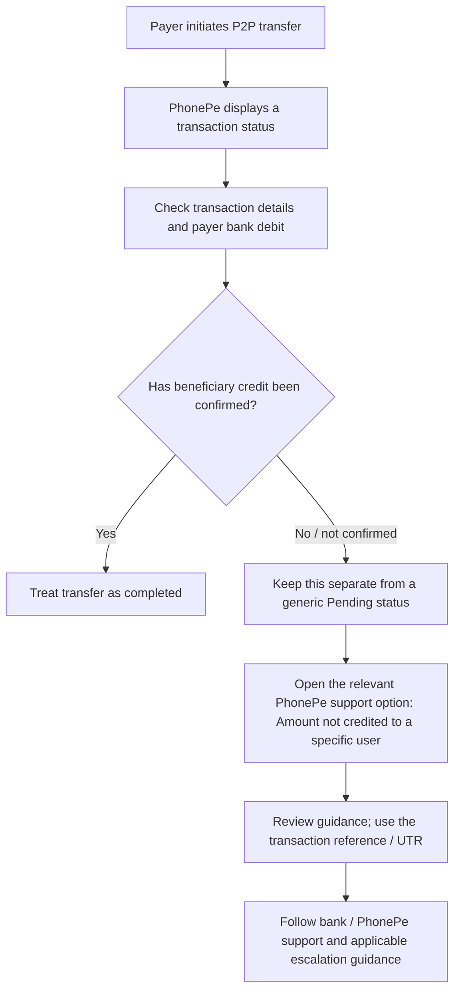
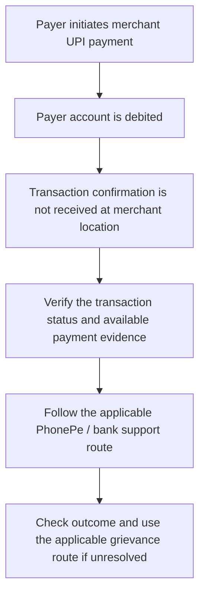
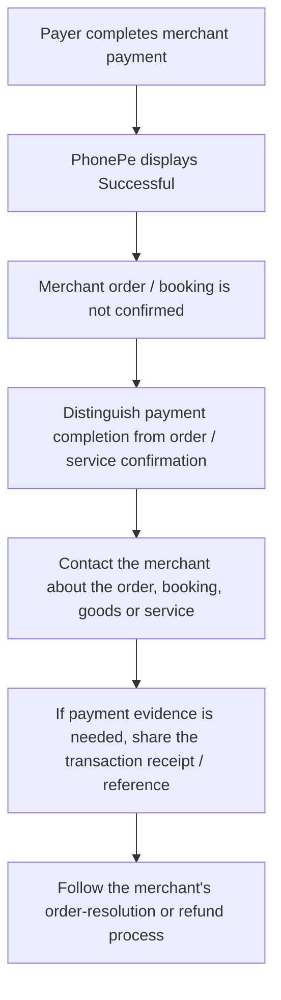

# Page 3 — P2P and P2M Workflows

> **Purpose:** Show how the payer's recovery path changes by transaction type and by the specific problem being reported. These are evidence-informed journey models, not claims about PhonePe's backend architecture.

## The central distinction

A UPI transaction status, the movement of money between bank accounts, merchant payment confirmation, and an order/booking confirmation are related but distinct signals. The recovery path depends on which of these is uncertain.

---

## 1. P2P — Payer debited, beneficiary says money not received

**What the inspection established**

- The inspected successful P2P transaction showed a successful status, recipient details, transaction reference, payment details, receipt sharing and support access.
- The support journey displayed recipient and bank details, transaction context, and issue suggestions including **“Amount not credited to a specific user”** and a bank-dispute option.
- PhonePe Help content inspected by the researcher describes a pending-status update period of up to 48 hours, relevant failed-payment refund guidance, UTR use and bank follow-up.

**Important boundary:** A `Pending` status alone does not prove that the sender was debited or that the beneficiary was not credited. Verify the payer's account debit and the beneficiary's account outcome separately. The live pending/failed transaction screens were not inspected in this audit.

---

## 2. P2M — Payer debited; transaction confirmation not received at merchant location

**Regulatory distinction**

RBI's 20 September 2019 failed-transaction framework describes a specific UPI P2M incident: the account is debited but transaction confirmation is not received at the merchant location. For that defined incident, the circular specifies auto-reversal within **T+5 days** and compensation of **₹100 per day** for delay beyond T+5. This is not a universal deadline for order cancellations, merchant refunds, delivery problems or every complaint in which a merchant says it cannot see a payment. Confirm that the facts match the circular before applying this rule.

**PhonePe guidance observed**

PhonePe Help contains a route for a merchant disputing receipt after a payment is shown as successful. The article says PhonePe marks a payment successful after receiving confirmation that money reached the merchant, and directs the payer to report the issue through PhonePe when the merchant disputes receipt. Attribute this explanation to PhonePe Help; do not present it as an independent verification of merchant-side records.

---

## 3. P2M — Payment successful; order or booking not confirmed

**What the inspection established**

- The inspected successful P2M transaction showed the successful status, reference information, payment details, receipt-sharing functionality and support access.
- PhonePe Help distinguishes a merchant disputing receipt of payment from an order or booking not being confirmed.
- For an order/booking or service issue after successful payment, the inspected PhonePe guidance directs the payer to contact the merchant. PhonePe does not necessarily receive confirmation that the merchant accepted the order or provided the service.

**Key distinction:** A successful payment does not, by itself, prove that the merchant's order or booking system has confirmed the purchase. Conversely, an unconfirmed order does not automatically mean the UPI payment failed.

---

## Quick comparison

| Scenario | What is uncertain? | First response path evidenced in the research | What not to assume |
|---|---|---|---|
| P2P: beneficiary not credited | Beneficiary account credit | PhonePe's “Amount not credited to a specific user” support option; UTR and bank follow-up guidance | Pending alone proves non-credit; payer debit proves beneficiary non-credit |
| P2M: merchant confirmation not received | Payment confirmation at merchant location | Verify payment details and follow the relevant PhonePe / bank support route | Every merchant dispute is automatically the RBI-defined P2M failed-transaction case |
| P2M: order/booking not confirmed | Order or service fulfilment | Contact the merchant; share transaction proof if needed | Successful payment means the order is confirmed |

## Regulatory callout — keep the two UPI incidents separate

| RBI-defined incident | Auto-reversal deadline | Delay compensation |
|---|---:|---:|
| P2P funds transfer: account debited, beneficiary not credited | T+1 | ₹100/day beyond T+1 |
| P2M merchant payment: account debited, transaction confirmation not received at merchant location | T+5 | ₹100/day beyond T+5 |

`T` is the transaction date. These are scenario-specific provisions from RBI Circular RBI/2019-20/67 dated 20 September 2019. They are not substitutes for PhonePe's Help wording or a guarantee that every merchant/order issue qualifies. See the official RBI circular and annex: https://www.rbi.org.in/commonman/Upload/English/Notification/PDFs/CIRCULAR677EC931A7A65E4D99AA957D8E85BC0A2A.PDF

## Evidence and limitations

**Directly inspected in the live app:** one existing successful P2P transaction details/support journey and one existing successful P2M transaction details/support journey. The researcher did not initiate a failed payment or submit a false complaint.

**Observed in PhonePe Help:** pending-status and refund guidance, UTR/bank follow-up instructions, P2P beneficiary-not-credited support, merchant payment-dispute guidance, and separate order/booking issue guidance. Use the canonical `Evidence_Register.xlsx` and `Screenshot_Index` for the exact evidence IDs and screenshot filenames.

**Not verified in the live app:** current P2P/P2M pending and failed screens; the complete complaint submission/tracking journey; actual beneficiary/merchant-side bank records; how frequently users encounter these issues; and whether the current experience causes confusion or repeat payments.

**Interpretation rule:** The diagrams are reconstructed user-recovery journeys based on observed screens, PhonePe Help and the scenario-specific RBI framework. They are not verified backend sequence diagrams and do not establish transaction-system root causes.

---

## PDF layout guidance

- Use the P2P flow in the upper-left or top section.
- Show the two P2M cases as separate side-by-side flows: merchant payment confirmation vs order/booking confirmation.
- Keep the RBI T+1/T+5 comparison in a small bottom callout, with the exact scenario labels intact.
- Add evidence IDs from the canonical workbook after checking each ID against the corresponding source row.
- Label the page **“Reconstructed payer journeys — based on inspected app screens and Help guidance”** rather than “PhonePe system architecture.”
