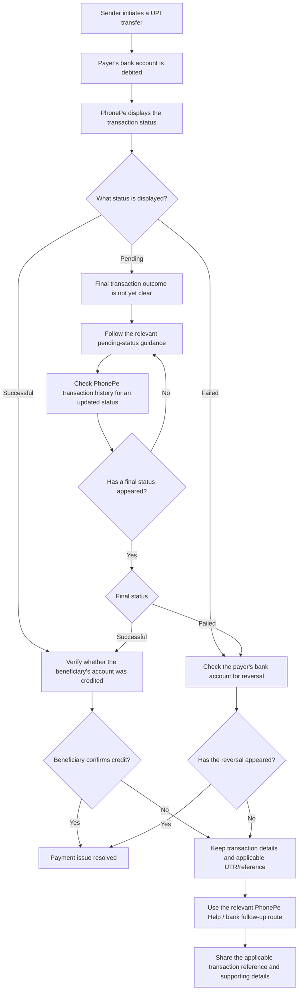
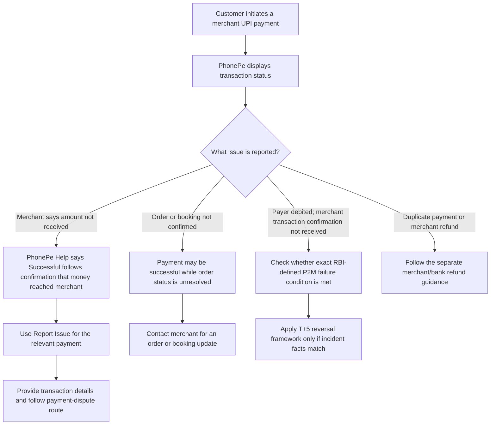

# PhonePe Product Teardown — Workflow Diagrams

**Purpose:** Report-ready conceptual diagrams for the two scoped UPI payment scenarios. These diagrams describe payer-facing investigation and recovery paths; they do not represent PhonePe's internal backend architecture.

## Legend and interpretation

- **Scenario / event:** A step stated in the scoped scenario.
- **Observed guidance:** A statement or route found in PhonePe Help content inspected for this teardown.
- **Proposed action:** A recommended payer action or product improvement, not a claim that the live app currently provides it in this exact form.
- A merchant's lack of confirmation does **not** establish that the merchant's bank account was not credited.
- Payment status, beneficiary/merchant credit, merchant payment confirmation, and order confirmation are separate concepts.

---

## 1. P2P workflow — payer debited, beneficiary not credited

**Scoped scenario:** The sender's bank account has been debited, but the beneficiary says the funds have not been credited or cannot yet confirm receipt.

### P2P notes for the report

1. The diagram separates **PhonePe transaction status** from **beneficiary account credit**.
2. The inspected PhonePe Help content describes a pending-status update period of up to 48 hours and refund guidance of 3–5 days for relevant failed-payment scenarios. These refer to different stages and should not be presented as one universal timeline.
3. The applicable RBI turnaround requirement depends on the exact transaction scenario and regulatory classification. Do not place a blanket T+1 claim on every pending or failed P2P transaction. Cite the applicable RBI rule separately and explain its precise scope.
4. The diagram's follow-up route is a conceptual payer journey. Confirm the exact current in-app complaint path and tracking experience before describing them as live PhonePe functionality.

---

## 2. P2M workflow — separate merchant receipt dispute from order/booking issue

**Scope:** PhonePe Help documents two separate situations after a successful merchant payment. They must not be conflated with the RBI-defined P2M failed-transaction incident unless the specific debit and missing-merchant-transaction-confirmation conditions are established.

### P2M notes for the report

1. PhonePe Help states that a payment is marked Successful only after PhonePe receives confirmation that money has reached the merchant (E-021). Attribute this statement to PhonePe; it is not independent proof of bank settlement or merchant ledger reconciliation.
2. The same Help article says merchants do not inform PhonePe whether they confirmed the order or provided the service. A successful payment therefore does not establish order/booking confirmation (E-021).
3. If the merchant disputes receipt after a successful status, PhonePe Help directs the payer to `Report Issue` for the relevant payment (E-021).
4. If the order/booking is not confirmed after successful payment, PhonePe Help directs the payer to contact the merchant for an update (E-023).
5. The RBI T+5 rule applies to the defined P2M incident where the payer is debited but transaction confirmation is not received at the merchant location (E-029). Do not apply it automatically to an unconfirmed order, duplicate payment or every merchant dispute.
6. PhonePe Help already documents a UTR retrieval path (E-015). Do not recommend adding UTR access unless a current-flow audit demonstrates a retrieval/sharing problem.

## 3. Proposed product experience overlay

The following is a **recommendation**, not a verified current PhonePe screen:

1. **Explain status:** State what the displayed UPI status means and what it does not confirm.
2. **Separate issue types:** Distinguish a merchant receipt dispute from an unconfirmed order/booking, and explain PhonePe's stated Successful criterion with attribution.
3. **Provide the right next step:** Offer a contextual merchant-issue route when the payer reports missing confirmation.
4. **Expose transaction proof:** Make the applicable transaction reference easy to locate and copy/share, where available.
5. **Prevent premature retry:** Encourage verification of the original transaction before another payment is attempted.

## 4. Evidence and publication checklist

Before publishing these diagrams:

- Attach the relevant evidence IDs to each PhonePe Help statement in the report (for example, the pending, refund, UTR, and merchant-issue evidence already catalogued in the evidence register).
- Add the exact inspection date and source URL or article title for each Help page, where captured.
- Label conceptual paths and proposed actions so they cannot be mistaken for verified live app screens.
- Verify current P2P and P2M transaction-detail screens, including transaction-reference visibility and the actual complaint submission/tracking route.
- Keep RBI turnaround and compensation statements in a separate, precisely scoped regulatory note with an official citation.
- Do not infer technical root cause, merchant-bank credit, actual repeat-payment behaviour, or duplicate-payment incidence from these workflows alone.
